<div align="center">

# LabDots

**Um laboratório pra montar mascotes animados em SVG.**
Escolha formato, expressão, cor e estado, e leve pro seu projeto como um arquivo só, animado em CSS.

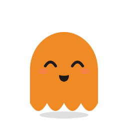
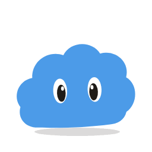
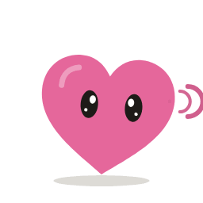
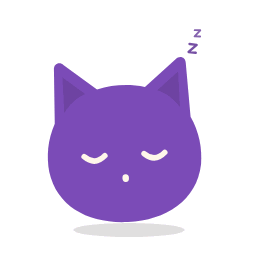

<sub>GIFs exportados pelo próprio LabDots.</sub>

</div>

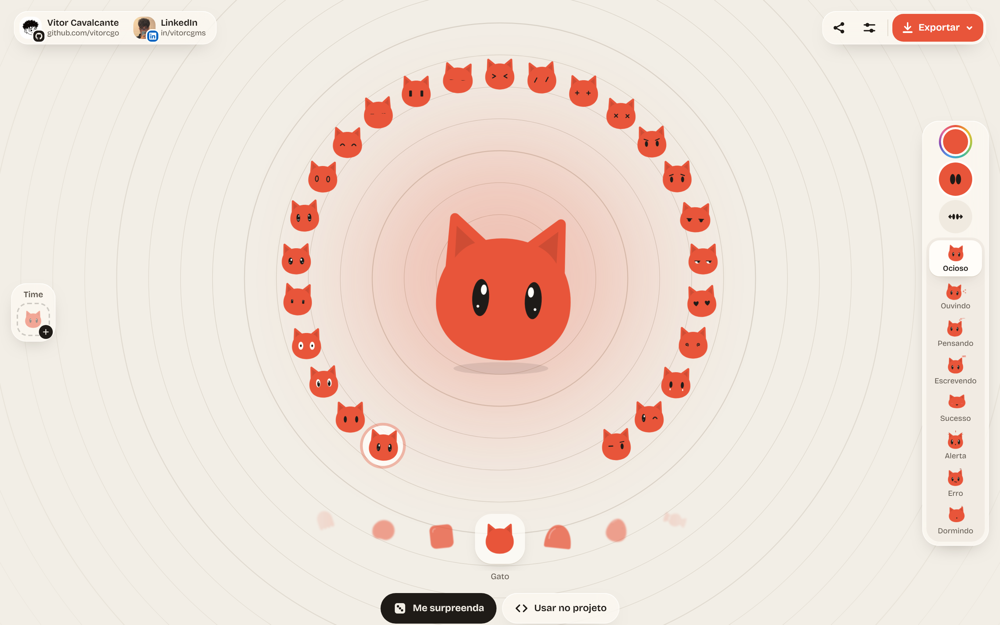

## Por que existe

Interfaces com assistente e agente precisam mostrar o que está acontecendo: ouvindo, pensando, escrevendo, deu certo, deu erro. Um personagem faz isso melhor que um spinner, só que desenhar e animar cada estado dá trabalho. O LabDots monta esse personagem em minutos e entrega um SVG leve, sem dependência e sem JavaScript.

## O que dá pra fazer

- **18 formatos**, cada um com detalhes e um jeito próprio de se mexer: seixo, nuvem, flor, fantasma, feijão, tofu, gato, gelatina, ovo, bala, morango, pinguim, sapo, robô, estrela, triângulo, coração e torrada.
- **25 expressões** de olhos, escolhidas no anel em volta do dot.
- **8 estados animados**: ocioso, ouvindo, pensando, escrevendo, sucesso, alerta, erro e dormindo.
- **Cor do corpo e cor dos olhos** num leque de amostras, ou qualquer cor pelo seletor livre. O reflexo dos olhos se ajusta sozinho ao tom.
- **Rosto ajustável**: arraste o rosto pra mudar a posição, e aproxime ou alargue os olhos no painel de olhos.
- **Time**: guarde vários dots e exporte todos de uma vez.
- **Link compartilhável**: o endereço guarda o dot inteiro, então quem abre vê exatamente o mesmo.
- **Tema claro e escuro**, e layout pensado do celular ao monitor.

| Leque de cores | Painel de olhos | Exportar |
| :---: | :---: | :---: |
| 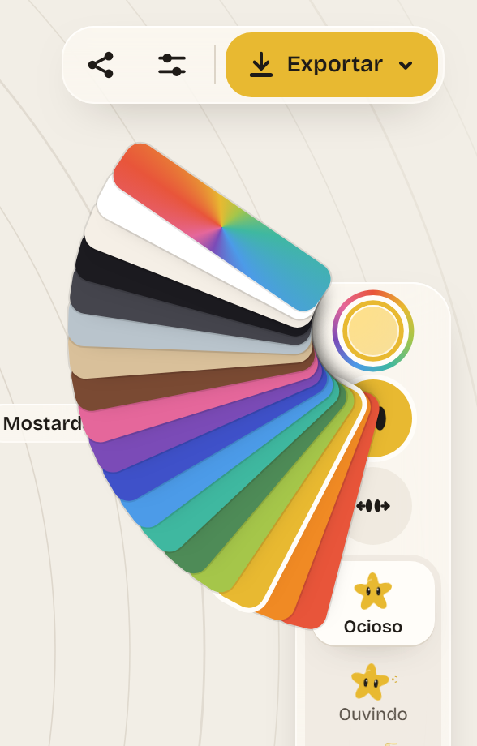 | 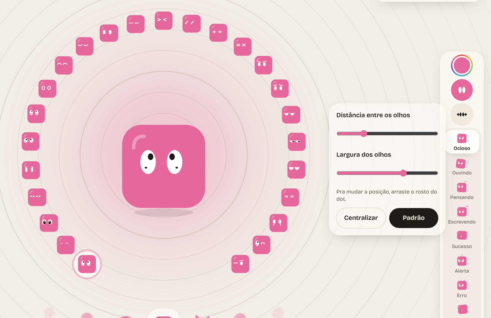 |  |

### Formatos

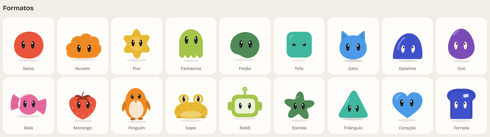

### Expressões

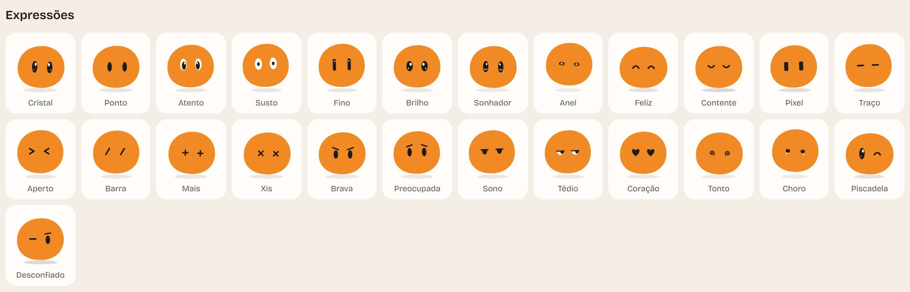

### Estados

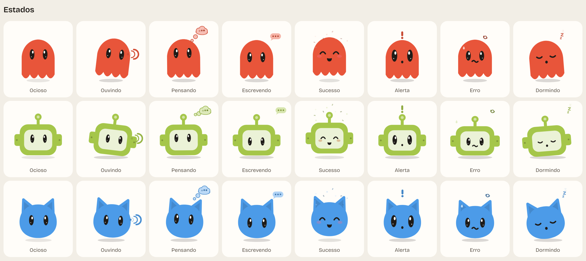

## Exportação

| Formato | O que sai |
| --- | --- |
| **SVG animado** | O estado atual, com a animação em CSS dentro do próprio arquivo |
| **SVG parado** | Um quadro, sem CSS, bom pra ícone |
| **SVG único** | Os 8 estados no mesmo arquivo, trocados por `data-estado` |
| **PNG** | Fundo transparente em 128, 256, 512 ou 1024 px |
| **GIF** | O ciclo do estado, com fundo branco ou transparente, pra usar no Figma |
| **Folha SVG** | Os 8 estados lado a lado, do dot ou do time inteiro |
| **Zip** | SVG, PNG e GIF de todos os estados, do dot ou do time inteiro |

## Usar no seu projeto

Em **Usar no projeto**, copie o SVG único e cole no HTML. Pra trocar de estado, mude o atributo:

```html
<!-- o SVG copiado do LabDots -->
<svg class="dot" data-estado="ocioso" ...>...</svg>

<script>
  const dot = document.querySelector("svg.dot");
  dot.dataset.estado = "pensando"; // ocioso | ouvindo | pensando | escrevendo | sucesso | alerta | erro | dormindo
</script>
```

A animação é toda em CSS dentro do SVG. Embutido no HTML ele troca de estado na hora. Usado como ``, fica no estado com que foi exportado.

## Em qualquer tela

| Celular | Celular, tema escuro | Tablet |
| :---: | :---: | :---: |
| 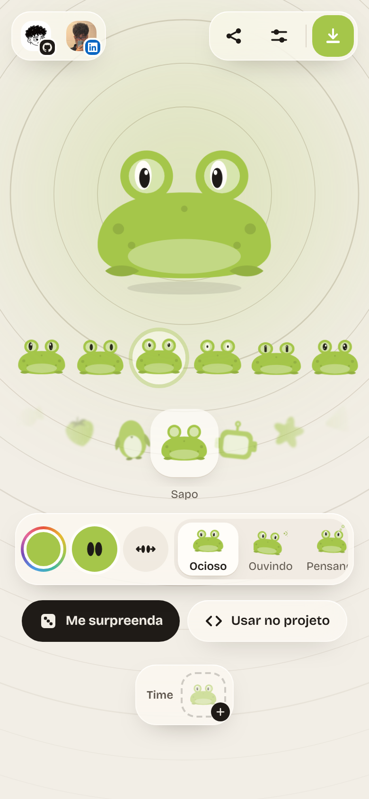 | 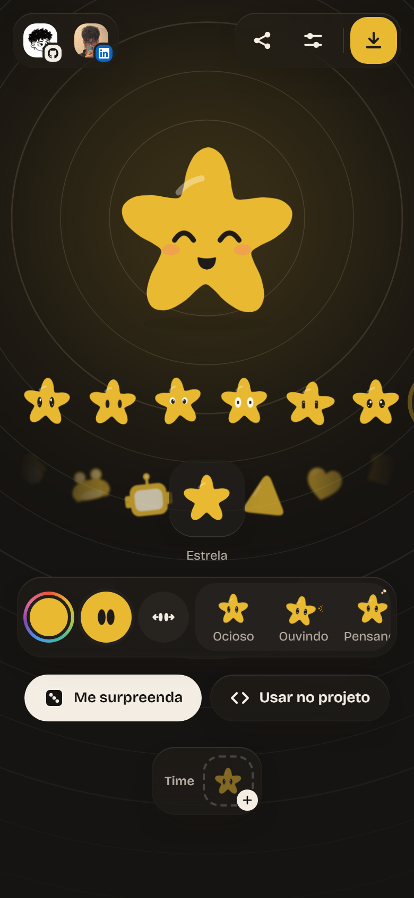 | 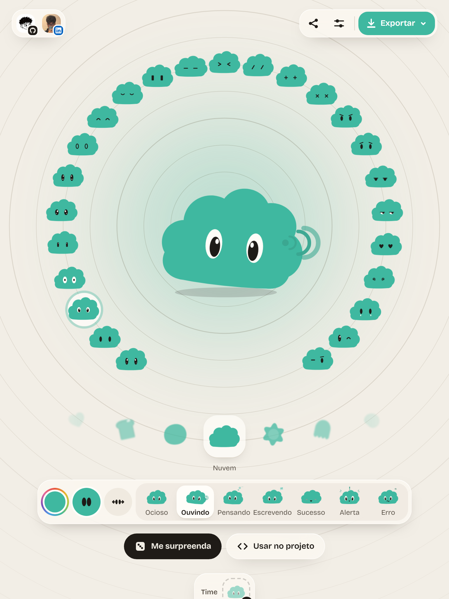 |

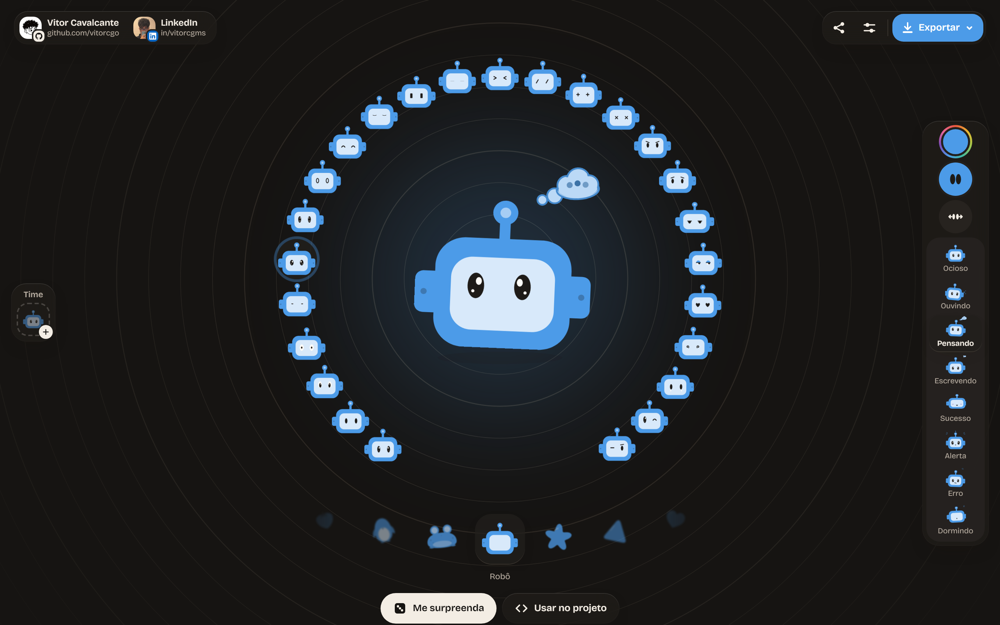

## Rodar localmente

Precisa de Node 24 e [pnpm](https://pnpm.io).

```bash
pnpm install
pnpm dev        # abre em http://localhost:4321
pnpm build      # gera o site estático em dist/
```

### Testes

Os testes rodam no Chromium com [Playwright](https://playwright.dev), em cima do build:

```bash
pnpm exec playwright install chromium
pnpm test
```

Eles passam por 7 tamanhos de tela (de 360 px a 1920 px) conferindo rolagem lateral, erros no console, alvos de toque de 44 px e sobreposição de elementos. Também clicam em tudo: expressões, formatos, estados pelo teclado, leque de cores, arraste dos olhos, time, ajustes e exportação de SVG, PNG e GIF.

As imagens deste README saem de `pnpm build && pnpm imagens`.

## Como funciona por dentro

```
src/
  lib/
    gerador.ts     monta o SVG: formato, rosto, estados e o CSS de cada um
    formatos.ts    os 18 formatos (desenho, caixa, posição dos olhos, jeito de se mexer)
    expressoes.ts  as 25 expressões
    estados.ts     os 8 estados e a duração de cada ciclo
  scripts/
    app.ts         a interface: anel, carrossel, doca, time e menus
    exportar.ts    PNG, GIF, folhas e zip
    rasterizar.ts  SVG pra imagem, quadro a quadro
  pages/
    index.astro    o laboratório
    catalogo.astro todos os formatos, expressões e estados numa página
```

Alguns detalhes:

- **Um SVG, oito estados.** Cada estado tem suas regras de CSS ligadas ao atributo `data-estado`, então trocar o estado não recria nada.
- **GIF sem servidor.** Pra cada quadro, o gerador pausa todas as animações naquele instante (`animation-play-state: paused` com atraso negativo), o navegador desenha o SVG num canvas e o [gifenc](https://github.com/mattdesl/gifenc) monta o arquivo. Cada estado fecha o ciclo no próprio tempo, então o GIF emenda sem pulo.
- **Cor ao vivo.** Os tons derivados (sombras, detalhes, bolhas) guardam a receita no atributo `data-tom`, então trocar de cor só repinta, com transição.

Feito com [Astro](https://astro.build), TypeScript e [Tailwind CSS](https://tailwindcss.com).

## Contribuir

Personagens novos e ideias são bem-vindos. Pra um formato novo, adicione uma entrada em `src/lib/formatos.ts`:

```ts
{
  id: "meu-formato",
  nome: "Meu formato",
  d: "M128 60C...Z",                          // contorno num quadro de 256 x 256
  caixa: [x0, y0, x1, y1],                     // onde o corpo ocupa, pra posicionar bolhas e zzz
  olho: { x: 128, y: 140, vao: 26, escala: 1.2 }, // centro do rosto e distância dos olhos
  jeito: "flutua",                             // movimento próprio: rola, deriva, balanca, flutua, inclina, amassa, treme, ginga
  detalhe: (tom) => `<circle ... ${tom("c0.4")}/>`, // opcional: detalhes em tons da cor do corpo
}
```

Confira em `/catalogo` se ficou bom em todos os estados e rode `pnpm test` antes de abrir o pull request. Pra sugerir algo sem código, abra uma [issue](https://github.com/vitorcgo/LabDots/issues).

## Licença

[MIT](LICENSE). Pode usar em qualquer projeto, pessoal ou comercial, mudar e redistribuir, desde que mantenha o crédito ao autor e o aviso da licença.

## Autor

Feito por **Vitor Cavalcante**.
[GitHub](https://github.com/vitorcgo) · [LinkedIn](https://www.linkedin.com/in/vitorcgms)

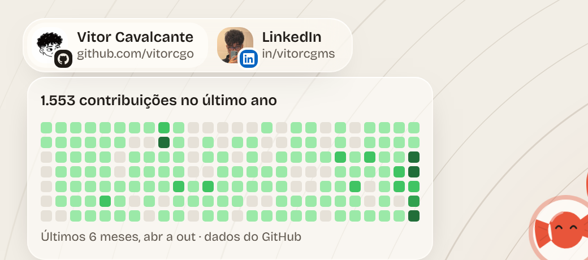
